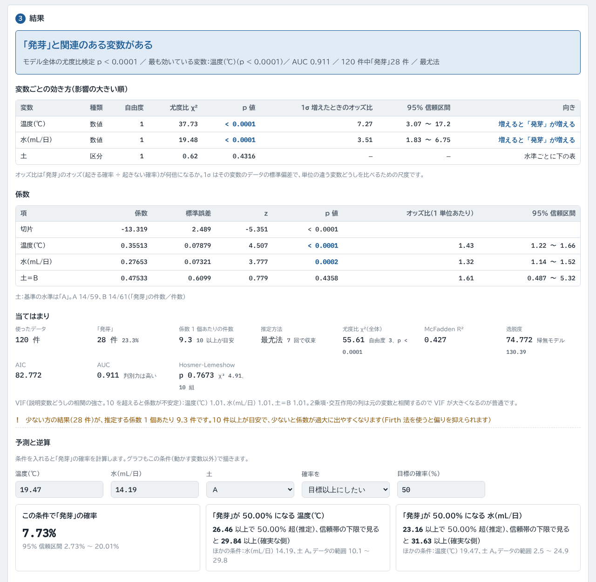
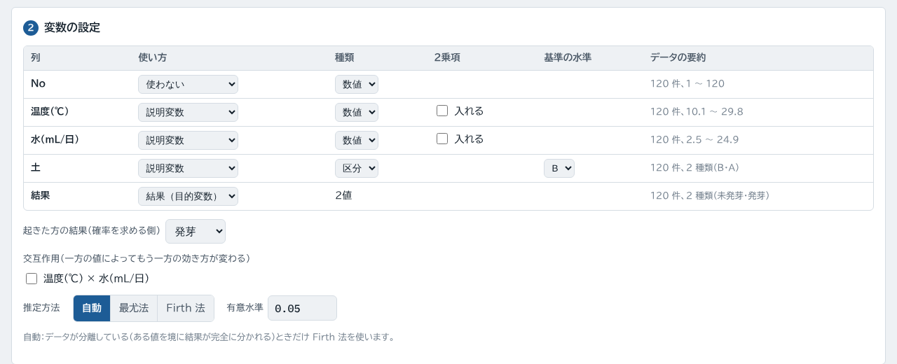
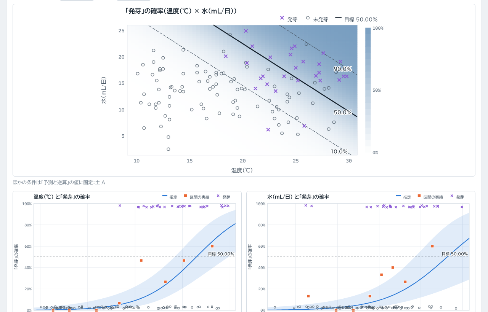

# 2値データの要因解析（logit-calc）

「合格・不合格」「発生した・しなかった」のように結果が 2 通りのデータと、温度・時間・濃度などの測定値の関係を**ロジスティック回帰**で解析する Web ツールです。どの変数が効いているか、起きる確率はどのくらいか、確率を目標以下（または以上）にするには各変数をいくつにすればよいかを計算します。

**https://kotaooka.github.io/logit-calc/**

インストールは不要で、ブラウザで開くだけで使えます。

- **データは外に出ません**。ファイルの読み込みと計算はすべてブラウザの中で行い、どこにも送信しません
- 入力した値はこの端末のブラウザに自動で保存し、次に開いたときに続きから使えます
- 一度開けば**オフラインでも動きます**。スマートフォンやPCにアプリとして追加することもできます

---

## 使い方

1. **データを入れる**：1 行 1 件（1 回の試験・1 個の観測）で、結果の列（合格／不合格、あり／なし、1／0 など 2 種類の値）と、説明に使う数値・区分の列を並べます。**Excel の表を見出しの行ごとコピーして、表の左上のセルに貼り付ける**か、Excel（.xlsx）・CSV を読み込みます。「サンプルデータで試す」で動作を確認できます
2. **変数を設定する**：結果の列と説明変数を自動で判別します。列ごとに使い方（結果・説明変数・使わない）、種類（数値・区分）、2乗項、区分の基準の水準を変えられます。数値の変数どうしの交互作用も入れられます
3. **結果を見る**：入力や設定を変えると自動で計算し直します

## 出力

| 出力 | 内容 |
|---|---|
| 変数ごとの効き方 | 尤度比検定の χ²・p 値（影響の大きい順）、1σ 増えたときのオッズ比と信頼区間、向き（増えると起きやすい・にくい） |
| 係数 | 係数・標準誤差・Wald 検定・1 単位あたりのオッズ比と信頼区間 |
| 当てはまり | 尤度比 χ²（全体）、McFadden R²、逸脱度、AIC、AUC、Hosmer-Lemeshow 検定、VIF、係数 1 個あたりの件数 |
| 予測と逆算 | 条件を入れたときの確率と信頼区間。確率が目標（例：1%）になる各変数の値を、推定値と**確実な側（目標以下にしたいなら信頼帯の上限、以上にしたいなら下限）**の両方で表示 |
| 判別 | しきい値を変えられる混同行列（感度・特異度） |
| グラフ | 2変数の**確率の地図**（等確率線と実データ）、変数ごとの確率の曲線（信頼帯・区間ごとの実績つき）、区分の水準ごとの確率、オッズ比の図、ROC 曲線 |
| 保存 | 結果の Excel ファイル（変数ごと・係数・当てはまり・データと予測確率）、印刷・PDF、グラフの PNG |

- **分離への対応**：ある値を境に結果が完全に分かれる（少ない試験でよく起こる）と、通常の最尤法は係数が無限大に発散します。これを検出すると **Firth 法**（罰則つき最尤法）に切り替えます。常に Firth 法を使うこともできます
- **2乗項**で「低すぎても高すぎても起きる」関係を、**交互作用**で「一方が大きいときだけもう一方が効く」関係を表せます

---

## 使うときの注意

- 関連があることは、原因であることを意味しません。要因を確かめるには、条件を計画的に変えた試験が必要です
- 起きなかった方の結果も必ず記録してください。少ない方の結果の件数が、推定する係数 1 個あたり 10 件以上あるのが目安です（少ないと画面に注意を出します）
- 逆算した値がデータの範囲の外なら外挿です（画面に表示します）
- **旧形式の .xls は読めません**。Excel で .xlsx に保存し直してください。CSV は UTF-8 と Shift_JIS に対応しています
- 計算結果は判断材料としてお使いください

---

## 計算の検証

計算は外部ライブラリを使わずに実装し、別の方法で計算した値と照合するテストを付けています（push のたびに GitHub Actions で実行）。

- 最尤法：statsmodels の Logit と、係数・標準誤差・p 値・対数尤度・AIC・BIC・McFadden R²・全体の尤度比検定を照合。変数ごとの尤度比検定は、縮小モデルを statsmodels で当てはめ直した値と照合
- Firth 法：罰則つき対数尤度を scipy で直接最大化した値（係数・罰則つき尤度比検定）と照合。完全分離のデータで自動切り替えも確認
- 予測確率の信頼区間：statsmodels の GLM（get_prediction）と照合。逆算は scipy の brentq と照合
- AUC は scikit-learn、VIF は statsmodels、Hosmer-Lemeshow は pandas で独立に実装した値と照合
- 区分・2乗項・交互作用を含む 5 通りのデータで確認

開発者向けの情報は [DEVELOPMENT.md](DEVELOPMENT.md) にあります。

## ライセンス

[MIT License](LICENSE)
